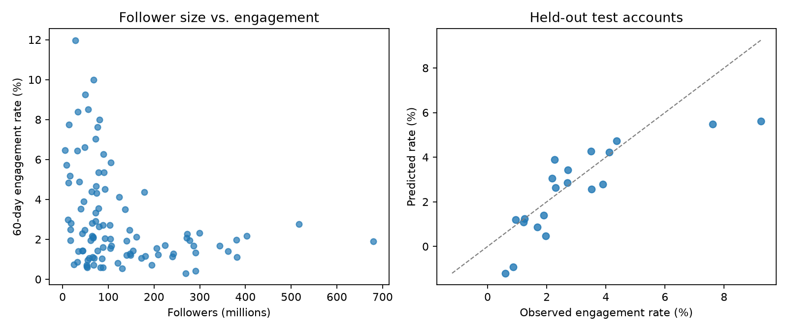

# Beyond follower counts: Instagram engagement

**Research question:** Among the top global Instagram accounts in this dataset, can follower count, posting volume, country, and content category predict 60-day engagement rate? Do accounts with more followers necessarily have higher engagement rates?

## Data story

The [Global Instagram Influencers Analytics 2026 dataset](https://www.kaggle.com/datasets/beamhonor0911/global-instagram-influencers-analytics-2026) is a snapshot of 100 high-profile accounts. Its `60_day_eng_rate` column is a percentage. In this snapshot, the median engagement rate declines across follower-count quartiles: **3.52%, 2.64%, 1.93%, and 1.68%** from the smallest to largest quartile. The Spearman correlation between followers and engagement rate is **−0.340**. Follower count alone is therefore a poor shorthand for engagement *rate* in this selected group. This is a descriptive association, not evidence that gaining followers reduces engagement.



## Reproduce

The original CSV is included in `data/` under the source's **CC0 Public Domain** license. It was downloaded from Kaggle's dataset API on November 10, 2026. With Python 3.10 or newer:

```bash
python -m venv .venv
source .venv/bin/activate
python -m pip install -r requirements.txt
python train.py
```

The command prints results and regenerates `results/metrics.json` and `results/engagement_story.png`. From another working directory, pass `--data` and `--output` paths explicitly. No Kaggle credentials are needed because the source CSV is included.

## Pipeline and evaluation

- **Target:** `60_day_eng_rate` (percentage points).
- **Inputs:** `followers`, `posts`, `country`, and `category`. Only these columns enter the model.
- **Split:** 80 training and 20 untouched test accounts using a fixed random seed of 42.
- **Preprocessing:** median imputation, `log1p`, and standardization for numeric features; most-frequent imputation and one-hot encoding for categories. The preprocessing is fitted on training data only.
- **Model:** Ridge regression with a fixed regularization setting (`alpha=10`). The comparison is a training-set median predictor. No model or hyperparameter was chosen using the test set.
- **Excluded columns:** `avg_likes`, `new_post_avg_likes`, and `total_likes` directly reflect engagement; `influence_score` and `rank` may encode engagement in their construction. `channel_info` is an account identifier. Excluding these helps prevent target leakage and memorization.

| Held-out test metric | Median baseline | Ridge pipeline |
| --- | ---: | ---: |
| Mean absolute error (percentage points) | 1.494 | **0.976** |
| Root mean squared error (percentage points) | 2.322 | **1.307** |
| R² | −0.181 | **0.626** |

These are the actual outputs from `python train.py` with the included CSV. The model improves on the median baseline by **0.518 percentage points of MAE** on this one split. The plot shows that it still underpredicts the highest-engagement test accounts.

## Limits and interpretation

This is only 100 already-popular accounts, with 20 in the test set. The results may change with a different split and should not be generalized to ordinary accounts or future posts. Category and country are observational labels, and their association with engagement is not causal. The dataset provides a current 60-day rate but no time series or collection method detailed enough to test future engagement forecasting. The task here is cross-sectional estimation for held-out accounts from the same snapshot.

## Classroom checklist

- Simple, runnable ML pipeline with splitting, preprocessing, model, and evaluation: `train.py`.
- Real results and a plot: this README and `results/`.
- Shareable repository: [sienna-wangxy/510-ML-pipeline](https://github.com/sienna-wangxy/510-ML-pipeline)
- Team of two: add both team members' names before submitting.
- **Do not submit the assignment yet.**
